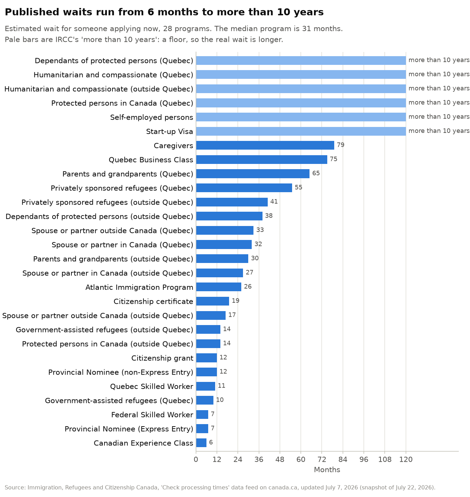
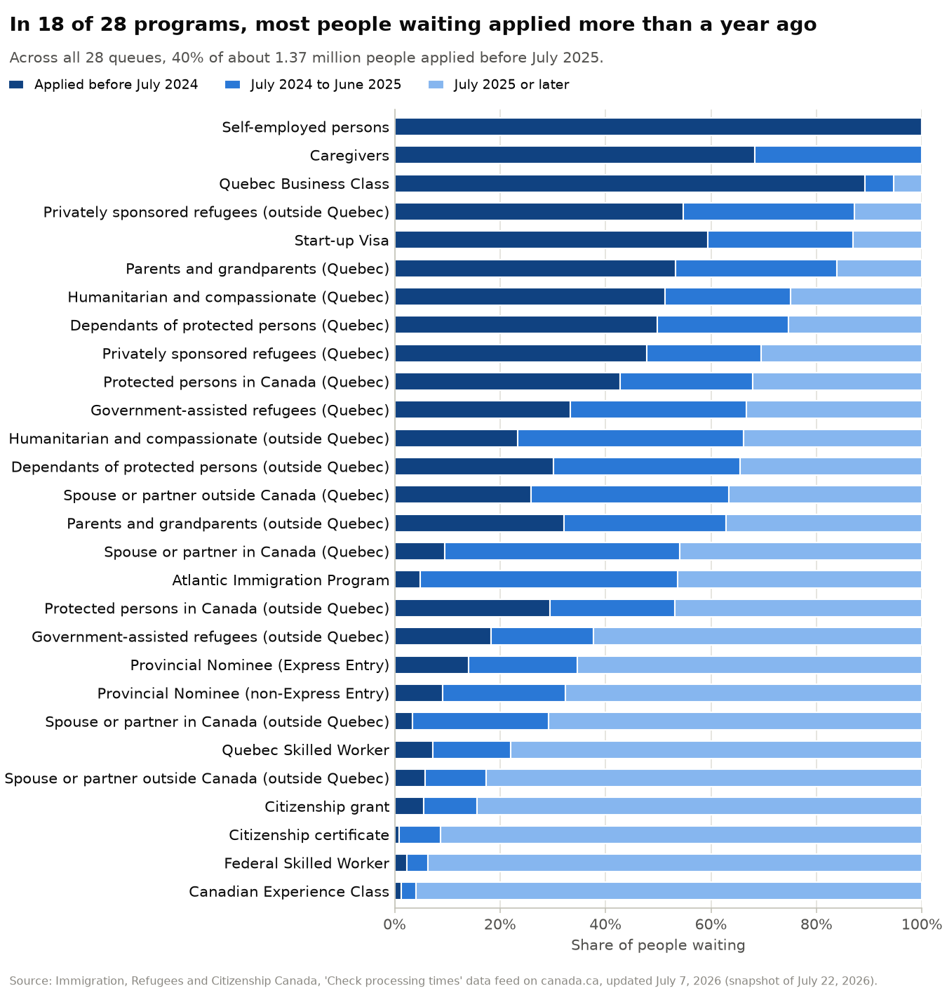
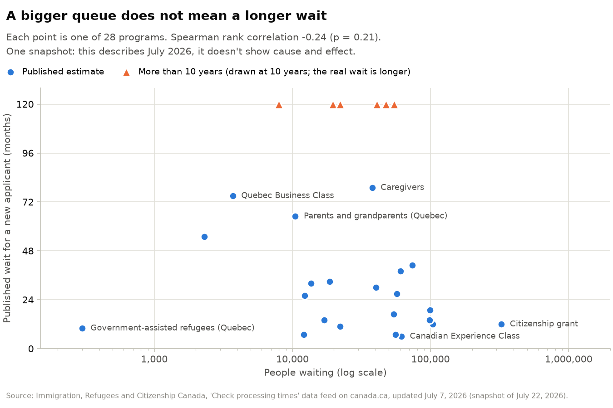
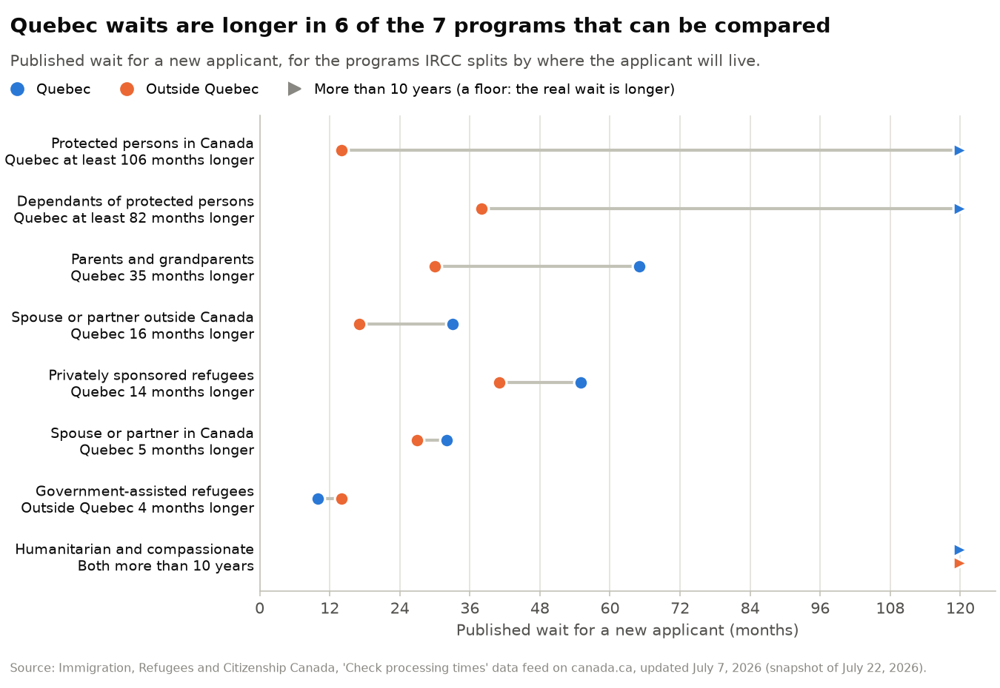
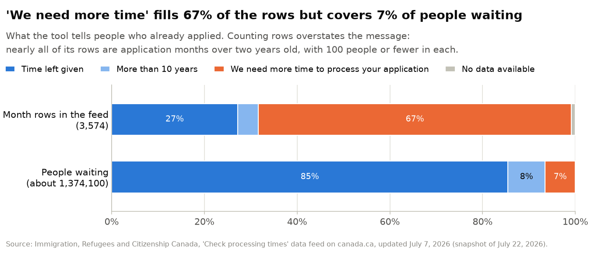

# IRCC processing times: one snapshot, July 2026

Immigration, Refugees and Citizenship Canada (IRCC) publishes an estimated wait for each permanent
residence and citizenship program. It also publishes month-by-month estimates for people who have
already applied: how many people are ahead of them and how much time is left. I saved one copy of
that data and used it to answer four questions with Python and pandas.

## Questions

1. Which application types take longest, and how wide is the spread?
2. How long have the people in each queue already been waiting?
3. Is a bigger queue linked to a longer published wait?
4. Are waits different for people going to Quebec?

I first planned to ask how much your country of residence changes the wait. This feed has no
country field, so I couldn't. IRCC's country breakdowns are for other application types, such as
visitor visas and study and work permits, which this feed doesn't cover. What the feed does break
down is the month you applied, so question 2 uses that instead.

## Findings

**1. Published waits run from about 6 months to more than 10 years.** For someone applying now, the
Canadian Experience Class has the shortest estimate, about 6 months. Six programs are listed only as
"more than 10 years": self-employed persons, Start-up Visa, humanitarian and compassionate cases
(inside and outside Quebec), and protected persons and their dependants going to Quebec. The median
program is 31 months, and 17 of the 28 programs are two years or more.



**2. About 40% of people waiting applied more than a year ago.** Across the 28 queues there are about
1,374,100 people. About 544,300 of them (39.6%) applied before July 2025, more than a year before
IRCC's update, and 272,600 (19.8%) applied before July 2024. In 18 of the 28 programs, most of the
queue applied more than a year ago. The newest queues are the Canadian Experience Class (4.1% applied
more than a year ago) and Federal Skilled Worker (6.3%). For caregivers and self-employed persons,
it's everyone in the queue.



**3. Inside a program, more people ahead means more time left. Across programs, queue size tells you
little.** Within each program, the time left goes up with the number of people ahead (median Spearman
correlation 0.99; lowest 0.84). IRCC says it bases the estimates on the applications it already has
and how many it expects to process each month, so I treat that as a check that I read the data
correctly. Across the 28 programs, the correlation between queue size and published wait is −0.24
(p = 0.21), or −0.26 (p = 0.24) without the six "more than 10 years" programs. That is no clear
relationship. Citizenship grants have the biggest queue (326,200 people) and a 12-month estimate.
Caregivers have 37,800 people and a 79-month estimate. Dividing each queue by its wait gives the pace
the estimate implies: from about 30 people a month (government-assisted refugees going to Quebec) to
about 27,200 (citizenship grants).



**4. Quebec waits are longer in 6 of the 7 programs that can be compared.** Parents and
grandparents: 65 months for Quebec against 30 elsewhere. Spouse or partner living outside Canada: 33
against 17. Protected persons in Canada: more than 10 years against 14 months. The exception is
government-assisted refugees, at 10 months for Quebec and 14 elsewhere. Humanitarian and compassionate
cases are "more than 10 years" on both sides, so they can't be compared. The Quebec queue is smaller
than the rest-of-Canada queue in all 8 pairs, so the longer waits aren't explained by queue size.
IRCC's processing-times page says that under the Canada–Quebec Accord, the Government of Quebec also
has to process these applications.



**5. Most month rows give no time, but few people get that answer.** In 2,412 of the 3,574 month rows
(67.5%), IRCC shows "We need more time to process your application" instead of a time. Weighted by the
number of people in each month, those months hold about 89,700 people, or 6.5% of everyone waiting.
Nearly all of those rows (96.6%) are application months more than two years old, and 95% of them hold
100 people or fewer. Counting rows instead of people would have made the gap look about ten times
bigger (67.5% against 6.5%).



## The data and its limits

- **Source:** IRCC's "Check processing times" feed,
  <https://www.canada.ca/content/dam/ircc/documents/json/flpt-en.json>. I downloaded it on 22 July 2026.
  IRCC marks it "last updated July 7, 2026" and updates it monthly. canada.ca only keeps the current
  file, so the dated copy in [`data/raw/`](data/raw/) is the only record of this month. It is unchanged
  (SHA-256 `e310bdb6e22718f324aace6dac45c18aa240e7fe2f4ed1abbeca971fa60f53f1`).
- **What's in it:** 28 programs (economic, family, refugee and humanitarian, citizenship). For each
  one there's the estimated wait for someone applying now and the number of people waiting. There are
  also 3,574 rows of program and application month, each with the time left and the number of people
  ahead.
- **One snapshot.** This shows July 2026 only. It can't show trends, or whether waits are getting
  better or worse.
- **Estimates, not outcomes.** These are IRCC's published estimates, not how long any real
  application took. IRCC says of its times: "They're not a maximum or a guarantee."
- **Rounded.** Every count in the feed is a multiple of 100 and every time is a whole number of
  months, so small differences mean little.
- **Floors.** For six programs the only figure is "more than 10 years", so their real value is unknown.
- **Small and not random.** 28 programs is a small set, and the correlations describe this one month.
  They don't explain why waits differ.

## Method

All the cleaning is in [`src/ircc_times/`](src/ircc_times/) and is covered by tests.

- **Units.** I keep every time in months, the unit IRCC uses in this feed. Turning "About 26 months"
  into days would add precision that isn't there. Years convert at 12 months. The parser also accepts
  days and weeks, using the average calendar month (365.25 / 12 = 30.44 days), because IRCC's visa and
  permit pages use them. None appear in this file.
- **Qualifiers.** "About", "more than" and "less than" are kept next to each number. "More than 10
  years" is stored as 120 months and marked as a floor. I rank floors but never average them.
- **Messages.** "We need more time to process your application" and "No data available" become
  missing values, not zero. A zero would read as "no wait" and pull averages down.
- **Counts.** "Less than 100 people ahead of you" becomes 100, the highest it could be. This can only
  overstate the 89,700 in finding 5, so the true share is, if anything, lower.
- **Unknown text stops the code.** Anything that doesn't match a known pattern raises an error
  instead of quietly becoming a missing value.

How each kind of text in the month rows was converted:

| Text in the feed | Rows | Stored as |
|---|---:|---|
| "N months left" | 876 | N months |
| "About 1 month left" | 95 | 1 month, qualifier "about" |
| "More than 10 years" | 160 | 120 months, marked as a floor |
| "We need more time to process your application" | 2,412 | missing, with the message kept |
| "No data available" | 31 | missing, with the message kept |

Before any analysis, the code checks three things and stops if one fails:

1. "People ahead of you" never goes down as the application month gets later. This lets me read it
   as a running total: everyone still waiting who applied in that month or earlier. Question 2
   depends on it. The number who applied more than a year ago is the running total for the last month
   before the one-year cut-off.
2. For the newest month, "people ahead" equals the total number waiting. This holds for all 28
   programs, so the two parts of the feed agree.
3. Every "more than 10 years" floor is above every ordinary estimate (the longest is 79 months). So
   the floors can be ranked as the longest waits, which keeps the median and the rank correlations
   valid.

For question 3 I use Spearman's rank correlation rather than Pearson's. It compares the order of the
two lists, not their raw values, so it can include the six programs that only have a floor.

## How to run it

You'll need Python 3.12.

```bash
python -m venv .venv
source .venv/bin/activate        # on Windows: .venv\Scripts\activate
pip install -r requirements.txt  # pinned versions, plus this repo's code in editable mode
pytest                           # tests for parsing, units, the tidy tables and the checks
python make_figures.py           # rebuilds figures/ and prints the headline numbers
```

[`analysis.ipynb`](analysis.ipynb) walks through the same steps with the outputs saved, including
every number quoted above. It uses the same functions as `make_figures.py`. To re-run it:

```bash
jupyter nbconvert --to notebook --execute --inplace analysis.ipynb
```

```text
data/raw/flpt-en-2026-07-22.json   the snapshot, unchanged
src/ircc_times/parse.py            text such as "About 26 months" into numbers
src/ircc_times/load.py             the JSON into two tidy tables
src/ircc_times/analysis.py         the calculations for each question
src/ircc_times/figures.py          the charts
tests/                             pytest tests
analysis.ipynb                     the walk-through, with outputs
make_figures.py                    rebuilds figures/ without Jupyter
```

## What I'd do next

- **Save the feed every month.** A scheduled GitHub Action could download it into `data/raw/` with
  the date in the file name. With a few months of snapshots I could see whether estimates and queues
  are going up or down. I could also check whether the "time left" for a given application month
  really drops by about a month each month, which would test how accurate IRCC's estimates are.
- **Add the temporary residence data**, which has the country breakdown I couldn't use here.

## Source and licence

Source: Immigration, Refugees and Citizenship Canada, ‘Check processing times’ data feed on
canada.ca, snapshot 22 July 2026. Reproduced for non-commercial analysis; this is not an official
version.

The code is released under the MIT licence (see [`LICENSE`](LICENSE)). The data belongs to IRCC and
is reproduced under the canada.ca
[Terms and conditions](https://www.canada.ca/en/transparency/terms.html). It is a copy of the
version that was available at the feed address above on 22 July 2026.

---

Manoj Kumar · [manojkumar-ca.vercel.app](https://manojkumar-ca.vercel.app)
